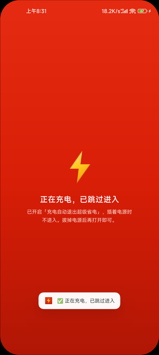
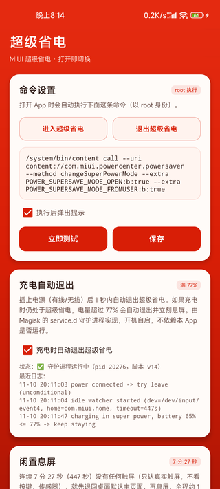

# 超级省电 APK（ExtremePowerSaver）

小米 11 / Android 13 / MIUI 14 上一键进入「超级省电模式」的 Kotlin APK。
**打开即执行**，无需点击；通过 root 调用 MIUI 原生开关，效果与手动点击完全一致
（含切换深色省电桌面、关闭后台、限制性能等）。

> 本方案已在真机（M2011K2C / Android 13 / MIUI V140 / V14.0.10.0.TKBCNXM / Magisk）上
> 反复实测通过。

<p>
  
  
</p>

## 外观

- **图标**：喜庆大红底 + 金黄色闪电，走 adaptive icon（自适应图标），
  在圆角方形 / 圆形 / 水滴等不同启动器蒙版下都是红底闪电。
- **界面**：主界面、设置页统一铺满大红底色（状态栏、导航栏同色，视觉无缝），
  内容放在白色卡片里；加载中、成功、失败、跳过等任何状态都是同一套红底，
  不会闪出黑屏或白屏。

## 功能

- **打开即进入**：点图标直接切到 MIUI 原生超级省电模式，无确认弹窗、无需二次点击。
- **插电自动退出**：进入省电后接上电源，1~8 秒内自动退出。
  由 root 守护进程实现（不依赖 App 存活），因此超级省电把 App 冻结后依然有效。
- **充电满 77% 自动退出并息屏**：充电中如果还停在超级省电里（插电后又手动进去的那种），
  电量一超过 77% 就自动退出超级省电，并把还亮着的屏幕直接关掉。
- **闲置息屏**：连续 7 分 27 秒（447 秒）没有任何触屏，自动退回桌面默认主页面并息屏。
  只认真实触屏（不看按键、传感器），**超级省电模式下不生效**。
- **命令可改**：默认内置「进入 / 退出」两条命令，也可以换成任意 root 命令。

## 环境要求

| 项 | 要求 |
|---|---|
| 机型 | 小米 / 红米 / POCO —— 依赖 `com.miui.securitycenter` 的 `PowerSaverProvider` |
| 系统 | MIUI（实测 MIUI 14 / Android 13）；必须 **root**（Magisk / KernelSU / APatch） |
| 构建 | JDK 17 + Android SDK 34（`compileSdk 34`） |

非小米系机型没有 `com.miui.powercenter.powersaver` 这个 provider，**装上也无法工作**。

## 免责声明

本工具通过 root 调用 MIUI 系统服务的非公开接口，**使用风险自负**。
作者仅在自己的设备上验证；不同 MIUI 版本、机型、地区版可能行为不同，
甚至可能因系统差异导致功能无效。请自行评估后再安装。

---

## 一、重要：网上流传的 `EXTREME_POWER_SAVE_MODE_OPEN` 是无效的

实测结论（务必先看，能省你很多时间）：

| 做法 | 结果 |
|---|---|
| `settings put system EXTREME_POWER_SAVE_MODE_OPEN 1` | 值能写入，但**桌面不切换、系统无任何动作**。这个键没人监听，纯状态残留 |
| `settings put system POWER_SAVE_MODE_OPEN 1` | 只触发 `PowerSaveModeManager.onPowerSaveChanged`，**仍不切换桌面** |
| `am start -a com.miui.powercenter.SUPERPOWER_SAVE` | 只打开设置页，不执行 |
| `am start .../SuperPowerProgressActivity` | 该 Activity 是 `exported=false`，单独拉起只是一闪而过 |
| `cmd statusbar click-tile ...SuperPowerTileService` | 该服务 `enabled=false`，且 MIUI 阉割了 `cmd statusbar` 的 click-tile |

**真正能切换的是 `com.miui.securitycenter` 里的 `PowerSaverProvider`。**

## 二、真正的调用方式（本 APK 用的就是它）

反编译 `MIUISecurityCenter.apk` 得到 `PowerSaverProvider.call()` 的分发逻辑：

```
if ("changeSuperPowerMode".equals(method)) a(bundle, false);
    // a(bundle, fromuser) 会读：
    //   POWER_SUPERSAVE_MODE_OPEN   (boolean)  —— 开/关
    //   POWER_SUPERSAVE_MODE_FROMUSER (boolean) —— 是否视为用户操作
```

对应到命令（**root 执行**）：

```bash
# 进入超级省电
/system/bin/content call --uri content://com.miui.powercenter.powersaver \
  --method changeSuperPowerMode \
  --extra POWER_SUPERSAVE_MODE_OPEN:b:true \
  --extra POWER_SUPERSAVE_MODE_FROMUSER:b:true

# 退出超级省电
/system/bin/content call --uri content://com.miui.powercenter.powersaver \
  --method changeSuperPowerMode \
  --extra POWER_SUPERSAVE_MODE_OPEN:b:false \
  --extra POWER_SUPERSAVE_MODE_FROMUSER:b:true
```

验证成功的标志（logcat）：

```
W SuperPowerSaveManager: switchSuperPower enter super power :
    bSuperPower(true)-fromuser(true)-powerpercent(69)-userenterstate(true)-userleavestate(false)
```

随后前台会变成 `com.miui.securityadd/com.miui.superpower.SuperPowerLauncherActivity`
（深色极简省电桌面）。

## 三、安装与使用

```bash
# MIUI 默认拦截 adb install，用 root 装（或手动传手机点安装）
adb push 超级省电.apk /data/local/tmp/eps.apk
adb shell su -c "pm install -r -t /data/local/tmp/eps.apk"
```

1. 打开 App → **首次会弹 Magisk 超级用户请求，必须点「允许」**（建议选"永久"）。
   若误点拒绝，去 Magisk → 超级用户里把「超级省电」改成允许。
2. 之后每次点开图标，就会自动进入超级省电模式。
3. 长按图标 → 「命令设置」：可改命令、切换成"退出超级省电"预设、立即测试。

## 四、充电相关自动化：插电即退 / 满 77% 退出并息屏

### 4.1 为什么不能像普通 App 那样监听

| 常规做法 | 为什么不行 |
|---|---|
| 注册 `ACTION_POWER_CONNECTED` 广播 | 超级省电会把第三方 App 冻结/杀掉，广播根本收不到 |
| 前台服务 + 监听 | 同样被冻结；还多一个常驻通知和耗电 |
| `JobScheduler` 充电约束 | 最小粒度分钟级，做不到"一插就退" |

所以做成 **root 守护进程**，和 App 完全解耦。

### 4.2 实现方式

App 把一个 shell 脚本安装到 Magisk 的 `service.d`：

```
/data/adb/service.d/eps_charge_watch.sh
```

关键设计（都是实测踩出来的）：

1. **开机自动启动**：Magisk 在 `late_start service` 阶段以 root 执行该目录下的脚本，不依赖 App 是否运行。
2. **自我脱壳**：脚本一启动就用 `setsid` 把真正的守护循环转入新 session，父进程 30ms 内返回。
   不这么做的话脚本会长时间阻塞 Magisk 的 boot stage。
3. **不被冻结**：脱壳后进程 `PPid=1`，位于 root cgroup（`0::/`），
   不在 App 的 `uid_xxxxx` cgroup 里，系统的 app freezer 管不到它。
4. **单实例 + 身份校验**：pidfile 里的 pid 必须能在 `/proc/<pid>/cmdline` 里匹配到
   `eps_charge_watch`，否则视为过期（重启后 pid 会被复用，不校验会误判甚至误杀别的进程）。
5. **检测口径**：读 `/sys/class/power_supply/{usb,ac,wireless,dc}/online`，
   与内核插电状态同源；用 shell 内建 `read` 读取，**不 fork 任何进程**。

触发逻辑（两条规则，同一个开关管）：

- **规则一 · 插电瞬间（边沿）**：不查任何设置键、也不看电量，直接调用一次退出命令。
  这是跨机型/跨 MIUI 版本最可靠的路径——不依赖 `POWER_SAVE_MODE_OPEN` 这类实现细节
  （不同版本可能是 `EXTREME_POWER_SAVE_MODE_OPEN` 等）。实测不在省电状态时调用是无害空操作。
- **规则二 · 充电中电量超过 77%**：充电期间每 30 秒复查一次，只有「确实还在超级省电
  且电量严格大于 77%」才退出，退出后立刻息屏。详见 4.8。
- 退出后会 `sleep 12`（规则一）／`sleep 8`（规则二）等 MIUI 切换动画结束，避免紧接着的复查误判。

### 4.3 开销实测（小米 11 / Android 13）

| 指标 | 实测值 | 说明 |
|---|---|---|
| CPU | 60 秒 **90ms ≈ 0.15% 单核** | 充电中、不在超级省电：两次 30 秒复查 |
| CPU | 60 秒 **110ms ≈ 0.18% 单核** | 充电中、停在超级省电：多读一次电量 |
| 内存 | **2.1 MB** | 单线程 shell |
| 待机唤醒 | **0** | 不持 wakelock；设备睡眠时循环随 CPU 挂起，不产生唤醒 |

读电量走 shell 内建 `read` 直读 sysfs，有没有这条规则在数字上看不出差别
（110 vs 90ms 那 20ms 是 `in_super_power` 多查了一次 Activity 栈）。

不充电时（也就是超级省电的常态）只读 sysfs，开销比上表还低一个量级。
插电时内核本身就会唤醒 AP，循环随之恢复，所以"睡眠中插电"不会漏检。

### 4.4 副作用（需要知道）

- 开启后，**充电中电量已超过 77% 时打开 App 不会进入超级省电**，
  会提示「电量 xx%，无需进入」。电量还在 77% 以下时照常进入，并且会一直留在里面，
  等电量涨过 77% 再由守护进程退出并息屏（就是 4.8 那条规则）。
- 会在系统里多一个文件 `/data/adb/service.d/eps_charge_watch.sh`；
  在设置页取消勾选会**删除脚本并杀掉进程**，不留残留。
- 若想"插着电也用超级省电"，把这个开关关掉即可（规则一、规则二都归它管）。

### 4.5 排障

```bash
adb shell su -c "cat /data/local/tmp/eps_charge_watch.log"   # 运行日志
adb shell su -c "cat /data/local/tmp/eps_charge_watch.pid"   # 当前 pid
adb shell su -c "grep EPS_SCRIPT_VERSION /data/adb/service.d/eps_charge_watch.sh"  # 脚本版本
```

设置页里也会直接显示「✅ 守护进程运行中（pid xxxx，脚本 vN）」和最近几行日志。

### 4.6 默认启用与脚本热升级（v1.1 起）

早期版本有个设计缺陷：`auto_exit_on_charge` 默认 `false`，而 `ensureInstalled()`
在开关关闭时直接 return。结果是**全新安装的设备上守护脚本压根不会安装**，
表现为「能进超级省电，但插电不退出」——看起来像功能失效，其实是没启用。

现在：

1. **默认启用**：装好 APK 打开一次，就会自动请求 root、把脚本落到
   `/data/adb/service.d/` 并立即拉起，无需进设置页手动勾选。
   用户在设置页显式关掉后，不再自动安装（尊重选择）。
2. **脚本版本自愈**：脚本内嵌 `EPS_SCRIPT_VERSION`，App 侧 `SCRIPT_VERSION` 与其比对，
   不一致就自动覆盖重装并重启进程。否则已安装的旧脚本永远不会升级，
   会出现「APK 更新了但行为还是老样子」。

排查「插电不退出」时，先看设置页状态行里的脚本版本号：显示 `v3` 以上才是当前逻辑。

### 4.7 日志里的 "daemon terminating" 是什么

v3 起终止信号用 `trap ... TERM INT HUP`，只记录**真实被杀**。
早期版本用的是 `trap ... EXIT`，而 `$(date ...)`、`$(settings get ...)` 这类命令替换
会 fork 子 shell 并继承 EXIT trap，子 shell 退出时也打一条 `daemon exiting`，
看起来像守护进程死了，实际主进程健康。如果你在旧日志里看到这种记录，可以忽略。

验证进程是否真的活着：

```bash
adb shell su -c 'P=$(cat /data/local/tmp/eps_charge_watch.pid); [ -d /proc/$P ] && echo ALIVE || echo DEAD'
```

注意不要用 `ps -A | grep eps_charge` 判断——Android 的 `ps` 只显示 15 字符的 `Name`（`sh`），
查不到脚本名。

### 4.8 充电中电量超过 77% → 退出超级省电 + 立刻息屏（v1.5 起）

**同时满足**三个条件才动手：正在充电、仍处于超级省电、电量**严格大于** 77%
（77% 不动，78% 才动）。

为什么需要这条：插电瞬间已经无条件退出过一次（规则一），但如果之后又进了超级省电
（从系统设置里手动进、或者插着电时点 App 图标进），手机就会一直以超级省电的状态充着电。
电量都过 77% 了，继续省电意义不大，还占着一块亮着的屏幕。所以充电期间每 30 秒复查一次，
条件满足就退出，并把屏幕关掉。

实现要点：

1. **电量读内核 sysfs**：`/sys/class/power_supply/battery/capacity`（兼容 `bms`、`maxfg`、
   `mtk-battery` 几种命名），用 shell 内建 `read`，**不 fork 任何进程**；
   不用 `dumpsys battery`，那要拉起一个 `app_process`（约 60ms），30 秒一次都嫌浪费。
2. **门槛可配**：`Prefs.EXIT_BATTERY_PCT`（默认 77）→ App 写进 cfg 的 `exit_battery_pct=`；
   脚本侧把非法值卡在 1~99（写成 0 会变成「一充电就退」，写成 100 等于关掉规则）。
3. **要先在超级省电里待满一分钟**：复查是 30 秒一次，规则要求**连续两次**复查都还在
   超级省电才动手（≈60 秒）。少了这一步，插着电点开 App 刚进去、下一秒就被踢出来顺手黑屏，
   看起来就像坏了。电量是后来才涨上去的（进省电时还没到门槛），就不受这条限制，
   涨过门槛的那次复查直接动手。
4. **退出后立刻息屏**：`KEYCODE_SLEEP` → 轮询 `mWakefulness` 确认真的黑了，被系统吞键就补发一次。
   屏幕本来就黑着则什么都不做（日志 `screen already off`），免得白拉两次 `app_process`。
5. **退出与息屏之间隔 1.5 秒**：超级省电的桌面切回普通桌面有转场，太早发 SLEEP 会被吞掉。

实测（小米 11，电量 65%、把门槛临时调成 60% 以便触发）：

| 时刻 | 事件 |
|---|---|
| 20:09:16 | 判定 `battery 65% > 60%`，下发退出命令 |
| 20:09:19.8 | `goToSleep(GO_TO_SLEEP_REASON_SLEEP_BUTTON)` |
| 20:09:20.0 | 屏幕真黑（`reason: 'screen_off'`） |

从判定到黑屏约 **4 秒**（含 1.5 秒等待转场 + 两次判屏）。日志：

```
charging + super power + battery 65% > 60% -> leave + screen off
screen off done
```

电量还没到门槛时只记一行，且每次充电只记一次（避免充一整晚刷满日志）：

```
charging in super power, battery 65% <= 77% -> keep staying
```

**想自己验证这条规则**（不用真的等到 77%）：把 cfg 里的门槛临时改小再重启守护进程。

```bash
adb shell su -c 'pkill -9 -f eps_charge_watch; rm -f /data/local/tmp/eps_charge_watch.pid /data/local/tmp/eps_charge_watch.idle.pid'
adb shell su -c 'printf "charge=1\nidle=1\nidle_timeout=447\nexit_battery_pct=60\n" > /data/local/tmp/eps_charge_watch.cfg'
adb shell su -c 'sh /data/adb/service.d/eps_charge_watch.sh'
# 然后插着电手动进一次超级省电，等 60~90 秒看日志：
adb shell su -c 'tail -f /data/local/tmp/eps_charge_watch.log'
```

看到 `battery 65% > 60% -> leave + screen off` 和 `screen off done` 就是生效了。
注意这只是临时生效：**App 下次启动会比对 cfg 与代码里的常量，不一致就覆盖回去**，
要长期改请改 `Prefs.EXIT_BATTERY_PCT` 重新编译。

如果要验证「不到门槛就不退」，就把门槛调回 77 以上（例如 99），
同样等 60~90 秒，日志里应当只有 `keep staying`，超级省电状态和屏幕都保持原样。

## 五、闲置息屏：7 分 27 秒没碰屏幕就回默认主页并息屏

### 5.1 需求边界

- 只监控**真实触屏**，不看按键、传感器、音量、音频播放
- 连续 7 分 27 秒（`447` 秒，写在 `Prefs.IDLE_TIMEOUT_SEC`）没有任何触屏 → 先回桌面**默认主页面**（两次 `KEYCODE_HOME`），
  确认落到主页之后再息屏（`KEYCODE_SLEEP`），整套动作 **1 秒左右**完成
- **超级省电模式下不生效**：省电模式有自己的休眠策略，这段逻辑会主动跳过
- 前提：系统设置里的「自动息屏」时间要大于 7 分 27 秒。否则系统先黑屏，
  本功能只会记一行 `screen already off -> skip`（它不会去点亮已经黑掉的屏幕）

### 5.2 为什么不能做成普通 App 功能

Android 没有「上次触摸时间」这种公开 API，几条常见路都走不通：

| 方案 | 为什么不选 |
|---|---|
| `AccessibilityService` 监听点击 | 要用户手动去无障碍里授权，事件粒度粗，滑动不触发 |
| 前台服务轮询 `dumpsys` | 几十毫秒一次，耗电比省下来的还多 |
| 读 `/proc/interrupts` 中断计数 | 依赖触屏中断名，换台机器基本对不上 |

所以直接读触屏设备的 evdev 节点，用**阻塞读**——有事件立刻返回，没事件就睡在内核里：

```bash
timeout 447 dd if=/dev/input/event4 bs=24 count=1 of=/dev/null
```

- 有触摸 → `dd` 立刻返回（rc=0），循环继续
- 447 秒一个事件都没有 → `timeout` 杀掉 `dd`（rc=124），判定为空闲

**关键细节：`count` 必须写 1。** dd 会一直读到凑满 count 个 block 才返回，
而一次轻触只产生 6~12 个事件——写成 `count=64` 会读不满、继续阻塞到超时，
把「用户正在操作」误判成「没人在用」。这个坑是在真机上撞出来的。

### 5.3 触屏节点怎么定位

扫 `/proc/bus/input/devices`，按名字匹配 `touch|fts|goodix|synaptics|nt36|gt9|ilitek|himax`，
**同时必须排除 `uinput-*`**：那是 `input` 命令和自动化脚本注入事件用的虚拟设备，
不排除的话用 adb 点一下屏幕就把计时重置了，等于监控失效。

小米 11 实测：

| 设备 | 节点 | 用途 |
|---|---|---|
| `fts` | `/dev/input/event4` | 真实触屏（Focus Touch Screen），要监控的就是它 |
| `uinput-goodix` | `/dev/input/event3` | 虚拟注入设备，必须排除 |

### 5.4 怎么判断「当前在超级省电模式」

这里踩过一个很隐蔽的坑：`EXTREME_POWER_SAVE_MODE_OPEN` 在小米 11 上**恒为 1**
（就是第一节说的那个没人监听的废弃键）。拿它判断会把「正常使用中」当成「省电模式」，
结果闲置功能被整段跳过——日志里只有一句 `idle 30s but super power active -> skip`。

实测可用的判据：

| 状态 | `POWER_SAVE_MODE_OPEN` | Activity 栈里 `com.miui.superpower` |
|---|---|---|
| 普通模式 | `0` | 0 行 |
| 超级省电 | `1` | 19~28 行 |

所以先用轻量的设置键，不命中再查 Activity 栈兜底（后者跨机型更通用，
但要 fork 一次 `dumpsys`，约 50ms，所以只当兜底）。

### 5.5 开销

- **不持 wakelock**：`dumpsys power` 里 `Wake Locks: size=0`，深度休眠不受影响。
  `dd` 阻塞在内核等待队列里，不是轮询，既不产生唤醒也不阻止挂起
- 有触摸时每个事件 fork 一对 `timeout`+`dd`，滑动时约 5~7 次/秒（0.15 秒节流控制）
- 空闲时的开销只跟「多久判一次屏幕」有关：447 秒周期下，每 447 秒才做一次 13ms 的
  `dumpsys power` 判屏，一天累计约 2.5 秒 CPU。实测折合 **约 0.003% 单核**，
  `4600mAh` 电池下 **0.005%/小时**量级，一天远低于 1%
- 周期越短开销越高（每次超时都要判一次屏）：7 秒验收配置约 0.2% 单核，
  是短周期调试的代价，正式配置不会这样

### 5.6 和充电退出怎么共存

两个功能共用同一个守护脚本，开关状态由 App 写在：

```
/data/local/tmp/eps_charge_watch.cfg
charge=1
idle=1
idle_timeout=447
exit_battery_pct=77
```

脚本启动时读一次。任一功能开启就保留脚本，两个都关才删脚本和进程。
App 每次启动会比对配置文件与开关状态，不一致就重装纠正（防止手工改过或旧版本残留）。

### 5.7 几个必须知道的实现细节

1. **动作要分三步走，不能一口气发完**：v9 是 `input keyevent 3 223` 一次把 HOME 和 SLEEP 发出去，
   两者只隔 30ms——键是发了，但桌面转场还没画完屏幕就黑了。后果是亮屏时看到「卡一下」，
   而且落点停在「打开 App 的那一页」，不是默认主页面。
   v10 改成 `HOME` → 等桌面接手 → 再 `HOME` → 等动画 → `SLEEP`，
   logcat 实测 **0.6~0.8 秒**（`HOME` 25.617 → `HOME` 25.836 → `goToSleep` 26.213，
   屏幕真黑 26.36），观感是「点到时间就回桌面、随即黑屏」，不再是先卡再黑。
2. **为什么按两次 HOME**：MIUI 桌面第一次 HOME 只回到「打开这个 App 的那一页」，
   在桌面上再按一次 HOME 才会跳回默认主页面。而连发 `input keyevent 3 3` 无效——
   第二个键落在转场动画里会被系统直接吞掉。所以中间必须先等前台真的切到桌面包名
   （`topResumedActivity` 含 `com.miui.home`，从系统里问出来，不写死），
   再留 120ms 给窗口动画收尾，然后才发第二个 HOME。
3. **动作期间用户碰了屏幕就整段放弃**：整套动作要跑 0.6~0.8 秒，这期间 `dd` 没在读触屏。
   用户这时点亮屏幕、点开某个 App，事件全堆在内核 buffer 里没人处理，
   动作照样一路执行到底——表现就是「刚点开就啪一下黑屏，还没到 7 分 27 秒」。
   现在每一步之间都插一次 10ms 的非阻塞探测（`timeout 0.01 dd ...`），
   一读到触屏事件就中止，屏幕保持亮着。我们自己发的按键不产生触屏事件，不会误判。
4. **息屏要确认真的黑掉**：`KEYCODE_SLEEP` 偶尔会被系统吞掉。发完轮询 `mWakefulness`
   （60ms × 8 次），没黑就补发一次。不确认的话下一轮超时又会再发一遍，
   表现成反复黑屏。
5. **屏幕已黑就不要再动**：少了判屏，息屏后每一轮超时都会再发一次 HOME+SLEEP。
   除了白烧两次 `app_process`，还会在你刚按电源键亮屏的瞬间把你黑掉——
   表现为「我自己亮屏，还没碰它就黑了」。
   现在超时后先查 `mWakefulness`，不是 `Awake` 就只记一行日志。
6. **刚亮屏的那一轮不作数**：如果上一轮判定时屏幕是黑的、这一轮变亮了，
   说明是刚被唤醒，这一轮只用来重置计时，不再补刀。
7. **孤儿自检**：idle 循环是主进程 fork 出来的子 shell。主进程被 `kill -9` 时
   trap 来不及执行，子 shell 会变成孤儿继续跑，替一个不存在的守护进程息屏。
   所以每轮循环都会 `kill -0 $$` 检查主进程（子 shell 里 `$$` 仍是主进程 PID），
   父进程没了就自己退出。
8. **脚本必须是 LF**：Windows 上编辑过的 `.sh` 带 CRLF，装到手机上每行都会报
   `inaccessible or not found`，而 `sh -n` 语法检查却是通过的（`\r` 被当成一个命令名）。
   安装时统一走 `tr -d '\r'` 兜底。
9. **闲置子进程必须用 `kill -9` 停**：它常年阻塞在 `timeout 447 dd` 上，
   而 `mksh` 的 trap 要等当前前台命令结束才执行——给主进程发 TERM 时主进程 2 秒内就退了，
   子进程却会一直卡在 `dd` 上，最长要等满 447 秒才看到 TERM。
   这段时间它仍然能执行「回桌面+息屏」，表现就是「开关已经关了、配置也换了，
   还会莫名黑屏」。所以脚本把子进程 pid 单独写到 `eps_charge_watch.idle.pid`，
   清理时一律 `kill -9`（SIGKILL 不可延迟），新实例启动时也会先清掉上一条命的残留。

## 六、编译

需要 JDK 17 + Android SDK（platform 34）。仓库自带 Gradle Wrapper（8.7）。

```bash
# local.properties 里写你自己的 SDK 路径（该文件已被 .gitignore 排除）
echo "sdk.dir=/path/to/Android/sdk" > local.properties

# Windows 下设置 JAVA_HOME 后
./gradlew assembleDebug
# 产物：app/build/outputs/apk/debug/app-debug.apk
```

> 从 GitHub 克隆后如果提示 `./gradlew: Permission denied`，先执行
> `chmod +x gradlew` —— 通过网页或 API 上传的文件不携带可执行位。

本机实测可用环境：JDK 17 + Android SDK platform-34（build-tools 34.0.0），
Gradle 由仓库自带的 Wrapper 8.7 提供，不需要单独安装。

## 七、代码结构

| 文件 | 作用 |
|---|---|
| `MainActivity.kt` | 打开即执行，检查 root → 执行命令 → 结果提示 → 退出；含"充电中电量已过 77% 就不进入"守卫 |
| `RootShell.kt` | su 探测与 `su -c` 执行封装（多路径探测 + 超时 + 被中断容错） |
| `ChargeWatch.kt` | 充电守护进程的安装/启停/状态查询（写 service.d、拉起、校验 pid 身份） |
| `SettingsActivity.kt` | 命令编辑、预设（进入/退出）、立即测试、充电自动退出开关与状态 |
| `Prefs.kt` | 命令与开关的本地存储 |
| `assets/eps_charge_watch.sh` | 守护脚本本体（开机自启 + 脱壳 + sysfs 轮询 + 调 provider 退出 + 满 77% 退出并息屏） |

## 八、已知问题与注意事项

- **首次运行必须在 Magisk 弹窗点「允许」**，否则 `su -c id` 返回 `Permission denied`，
  App 会提示"未获得 root 权限"。可通过 logcat 过滤 `EPS` 标签排查。
- 进入超级省电后，本 App 自身会被系统限制（这正是省电的目的），属正常现象。
- 若某次打开没反应，先看：
  ```bash
  adb logcat -s EPS:*
  adb shell settings get system POWER_SAVE_MODE_OPEN
  ```
- **不要用 `BatteryManager.isCharging()` 判断"是否插电"**：实测这台机器插着 USB 时
  `dumpsys battery` 显示 `USB powered: true / status: 2`，但 `isCharging()` 返回 `false`。
  要判断"插没插电源"，用 `ACTION_BATTERY_CHANGED` 的 `EXTRA_PLUGGED != 0`，
  它和内核 sysfs 的 `online` 同源，也和守护脚本的口径一致。
- 本 App 只下发切换命令，不联网、不上传数据；充电守护进程也不产生网络请求。
- 换 MIUI / HyperOS 版本后，若 `content call` 报 `IllegalArgumentException` 或无效，
  说明 provider 的 method 或 key 变了，需要重新反编译确认。

## 九、更新日志

### v1.5（当前版本，`versionCode 6` / 脚本 v14）

- **新增：充电中电量 > 77% 自动退出超级省电 + 立刻息屏**（4.8）。
  条件是「正在充电 + 仍处于超级省电 + 电量严格大于 77%」，充电期间每 30 秒复查；
  为避免刚手动进入就被踢，还要求在超级省电里待满约 60 秒才动手
- 电量门槛可配：`Prefs.EXIT_BATTERY_PCT`（默认 77），App 会写进 cfg 的 `exit_battery_pct=`
- 插电瞬间无条件退出（规则一）行为**不变**
- 充电中打开 App 不再一律跳过：电量 ≤ 77% 照常进入并一直保持，> 77% 才提示「无需进入」
- 退出后息屏会轮询确认真的黑掉，吞键则补发一次；屏幕本来就黑则不动
- 修：守护进程若在超级省电模式下启动，会把 `com.miui.securityadd`（超级省电桌面）
  记成「桌面」，导致之后回桌面动作等不到前台切换、白等 0.6 秒才靠超时兜底；
  改为动作发生时重新解析桌面包名
- 设置页第二张卡片加了「满 77%」标签并重写说明，文档配图重拍

### v1.4（`versionCode 5` / 脚本 v12）

- **闲置判定时长改为 7 分 27 秒（447 秒）**，常量在 `Prefs.IDLE_TIMEOUT_SEC`，改一行就能调
- 到点后**先回桌面默认主页面，确认落页之后再息屏**：`HOME` → 等桌面接手 → 再 `HOME`
  → 等动画 → `SLEEP`，实测判定到黑屏 **0.72 秒**（`05.077 → 05.796`）
- 动作执行期间用户碰屏幕就整段放弃，修掉「刚点开还没到时间就黑屏」
- 息屏后轮询 `mWakefulness` 确认真的黑掉，系统吞键则补发一次，不再出现反复黑屏
- **修一个会致命的老 bug**：闲置子进程常年阻塞在 `timeout N dd` 上，
  `TERM` 要等前台命令结束才执行，最长残留一整个超时周期——这期间它还能息屏。
  现在单独记录子进程 pid，清理一律 `kill -9`，新实例启动时先清残留
- 设置页标签改为「7 分 27 秒」，文档、配图同步更新

### v1.0 ~ v1.3（开发过程）

- v1.0：打开即进入超级省电，命令可自定义
- v1.2：加 Magisk `service.d` 守护进程，插电 1~8 秒自动退出超级省电；
  图标改为喜庆红底 + 金色闪电，全界面铺满红底
- v1.3：新增「闲置息屏」，用 evdev 阻塞读监控真实触屏

## 十、参考

最初思路来自社区里的一个 Vector / Xposed 模块（通过注入 `system_server` 监听电量来写设置键）。
该项目改为**普通 APK + root + 直接调用 PowerSaverProvider**，
打开即触发，无需 Xposed、无需刷框架。
