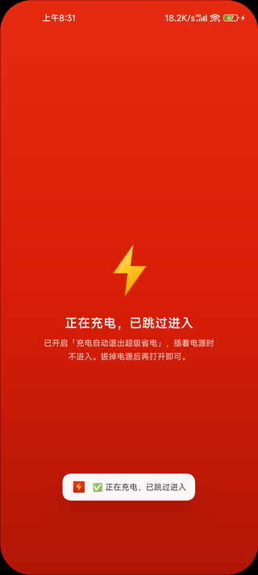
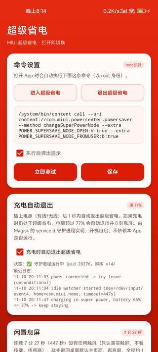
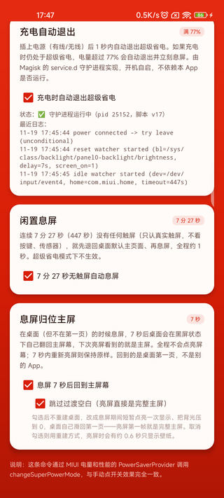

# 超级省电 APK（ExtremePowerSaver）

小米 11 / Android 13 / MIUI 14 上一键进入「超级省电模式」的 Kotlin APK。
**打开即执行**，无需点击；通过 root 调用 MIUI 原生开关，效果与手动点击完全一致
（含切换深色省电桌面、关闭后台、限制性能等）。

> 本方案已在真机（M2011K2C / Android 13 / MIUI V140 / V14.0.10.0.TKBCNXM / Magisk）上
> 反复实测通过。

<p>
  
  
</p>
<p>
  
</p>

## 外观

- **图标**：喜庆大红底 + 金黄色闪电，走 adaptive icon（自适应图标），
  在圆角方形 / 圆形 / 水滴等不同启动器蒙版下都是红底闪电。
- **界面**：主界面、设置页统一铺满大红底色（状态栏、导航栏同色，视觉无缝），
  内容放在白色卡片里；加载中、成功、失败、跳过等任何状态都是同一套红底，
  不会闪出黑屏或白屏。

## 功能

- **打开即进入**：点图标直接切到 MIUI 原生超级省电模式，无确认弹窗、无需二次点击。
- **插电自动退出**：进入省电后接上电源，1~8 秒内自动退出。
  由 root 守护进程实现（不依赖 App 存活），因此超级省电把 App 冻结后依然有效。
- **充电满 77% 自动退出**：充电中如果还停在超级省电里（插电后又手动进去的那种），
  电量一超过 77% 就自动退出超级省电；此时没在用手机（前台是桌面）才顺带息屏。
- **闲置息屏**：连续 7 分 27 秒（447 秒）没有任何触屏，自动退回桌面默认主页面并息屏。
  只认真实触屏（不看按键、传感器），**超级省电模式下不生效**。
- **息屏归位主屏**：在桌面但不在第一页的时候息屏，7 秒后桌面自己翻回主页面，
  **全程屏幕不亮**；7 秒内又亮屏则保持原样。见第六章。
- **跳过过渡空白**：归位默认用「静默翻页」，亮屏第一帧就是完整主屏，
  不会先黑一下、再只显示壁纸。见 6.7 / 6.8。
- **屏蔽 NFC 刷卡弹窗**（彩蛋）：刷门禁时不再弹出整页「请靠近读卡器」，
  卡模拟本身不受影响。见第八章。
- **卸载即自毁**：卸掉 APK 之后，守护脚本不会继续留在 `service.d` 里作妖。见第七章。
- **命令可改**：默认内置「进入 / 退出」两条命令，也可以换成任意 root 命令。

## 环境要求

| 项 | 要求 |
|---|---|
| 机型 | 小米 / 红米 / POCO —— 依赖 `com.miui.securitycenter` 的 `PowerSaverProvider` |
| 系统 | MIUI（实测 MIUI 14 / Android 13）；必须 **root**（Magisk / KernelSU / APatch） |
| 构建 | JDK 17 + Android SDK 34（`compileSdk 34`） |

非小米系机型没有 `com.miui.powercenter.powersaver` 这个 provider，**装上也无法工作**。

## 免责声明

本工具通过 root 调用 MIUI 系统服务的非公开接口，**使用风险自负**。
作者仅在自己的设备上验证；不同 MIUI 版本、机型、地区版可能行为不同，
甚至可能因系统差异导致功能无效。请自行评估后再安装。

---

## 一、重要：网上流传的 `EXTREME_POWER_SAVE_MODE_OPEN` 是无效的

实测结论（务必先看，能省你很多时间）：

| 做法 | 结果 |
|---|---|
| `settings put system EXTREME_POWER_SAVE_MODE_OPEN 1` | 值能写入，但**桌面不切换、系统无任何动作**。这个键没人监听，纯状态残留 |
| `settings put system POWER_SAVE_MODE_OPEN 1` | 只触发 `PowerSaveModeManager.onPowerSaveChanged`，**仍不切换桌面** |
| `am start -a com.miui.powercenter.SUPERPOWER_SAVE` | 只打开设置页，不执行 |
| `am start .../SuperPowerProgressActivity` | 该 Activity 是 `exported=false`，单独拉起只是一闪而过 |
| `cmd statusbar click-tile ...SuperPowerTileService` | 该服务 `enabled=false`，且 MIUI 阉割了 `cmd statusbar` 的 click-tile |

**真正能切换的是 `com.miui.securitycenter` 里的 `PowerSaverProvider`。**

## 二、真正的调用方式（本 APK 用的就是它）

反编译 `MIUISecurityCenter.apk` 得到 `PowerSaverProvider.call()` 的分发逻辑：

```
if ("changeSuperPowerMode".equals(method)) a(bundle, false);
    // a(bundle, fromuser) 会读：
    //   POWER_SUPERSAVE_MODE_OPEN   (boolean)  —— 开/关
    //   POWER_SUPERSAVE_MODE_FROMUSER (boolean) —— 是否视为用户操作
```

对应到命令（**root 执行**）：

```bash
# 进入超级省电
/system/bin/content call --uri content://com.miui.powercenter.powersaver \
  --method changeSuperPowerMode \
  --extra POWER_SUPERSAVE_MODE_OPEN:b:true \
  --extra POWER_SUPERSAVE_MODE_FROMUSER:b:true

# 退出超级省电
/system/bin/content call --uri content://com.miui.powercenter.powersaver \
  --method changeSuperPowerMode \
  --extra POWER_SUPERSAVE_MODE_OPEN:b:false \
  --extra POWER_SUPERSAVE_MODE_FROMUSER:b:true
```

验证成功的标志（logcat）：

```
W SuperPowerSaveManager: switchSuperPower enter super power :
    bSuperPower(true)-fromuser(true)-powerpercent(69)-userenterstate(true)-userleavestate(false)
```

随后前台会变成 `com.miui.securityadd/com.miui.superpower.SuperPowerLauncherActivity`
（深色极简省电桌面）。

## 三、安装与使用

```bash
# MIUI 默认拦截 adb install，用 root 装（或手动传手机点安装）
adb push 超级省电.apk /data/local/tmp/eps.apk
adb shell su -c "pm install -r -t /data/local/tmp/eps.apk"
```

1. 打开 App → **首次会弹 Magisk 超级用户请求，必须点「允许」**（建议选"永久"）。
   若误点拒绝，去 Magisk → 超级用户里把「超级省电」改成允许。
2. 之后每次点开图标，就会自动进入超级省电模式。
3. 长按图标 → 「命令设置」：可改命令、切换成"退出超级省电"预设、立即测试。

## 四、充电相关自动化：插电即退 / 满 77% 退出

### 4.1 为什么不能像普通 App 那样监听

| 常规做法 | 为什么不行 |
|---|---|
| 注册 `ACTION_POWER_CONNECTED` 广播 | 超级省电会把第三方 App 冻结/杀掉，广播根本收不到 |
| 前台服务 + 监听 | 同样被冻结；还多一个常驻通知和耗电 |
| `JobScheduler` 充电约束 | 最小粒度分钟级，做不到"一插就退" |

所以做成 **root 守护进程**，和 App 完全解耦。

### 4.2 实现方式

App 把一个 shell 脚本安装到 Magisk 的 `service.d`：

```
/data/adb/service.d/eps_charge_watch.sh
```

关键设计（都是实测踩出来的）：

1. **开机自动启动**：Magisk 在 `late_start service` 阶段以 root 执行该目录下的脚本，不依赖 App 是否运行。
2. **自我脱壳**：脚本一启动就用 `setsid` 把真正的守护循环转入新 session，父进程 30ms 内返回。
   不这么做的话脚本会长时间阻塞 Magisk 的 boot stage。
3. **不被冻结**：脱壳后进程 `PPid=1`，位于 root cgroup（`0::/`），
   不在 App 的 `uid_xxxxx` cgroup 里，系统的 app freezer 管不到它。
4. **单实例 + 身份校验**：pidfile 里的 pid 必须能在 `/proc/<pid>/cmdline` 里匹配到
   `eps_charge_watch`，否则视为过期（重启后 pid 会被复用，不校验会误判甚至误杀别的进程）。
5. **检测口径**：读 `/sys/class/power_supply/{usb,ac,wireless,dc}/online`，
   与内核插电状态同源；用 shell 内建 `read` 读取，**不 fork 任何进程**。

触发逻辑（两条规则，同一个开关管）：

- **规则一 · 插电瞬间（边沿）**：不查任何设置键、也不看电量，直接调用一次退出命令。
  这是跨机型/跨 MIUI 版本最可靠的路径——不依赖 `POWER_SAVE_MODE_OPEN` 这类实现细节
  （不同版本可能是 `EXTREME_POWER_SAVE_MODE_OPEN` 等）。实测不在省电状态时调用是无害空操作。
- **规则二 · 充电中电量超过 77%**：充电期间每 30 秒复查一次，只有「确实还在超级省电
  且电量严格大于 77%」才退出；前台不是普通 App 时再顺带息屏。详见 4.8 / 4.9。
- 退出后会 `sleep 12`（规则一）／`sleep 8`（规则二）等 MIUI 切换动画结束，避免紧接着的复查误判。

### 4.3 开销实测（小米 11 / Android 13）

| 指标 | 实测值 | 说明 |
|---|---|---|
| CPU | 60 秒 **90ms ≈ 0.15% 单核** | 充电中、不在超级省电：两次 30 秒复查 |
| CPU | 60 秒 **110ms ≈ 0.18% 单核** | 充电中、停在超级省电：多读一次电量 |
| 内存 | **2.1 MB** | 单线程 shell |
| 待机唤醒 | **0** | 不持 wakelock；设备睡眠时循环随 CPU 挂起，不产生唤醒 |

读电量走 shell 内建 `read` 直读 sysfs，有没有这条规则在数字上看不出差别
（110 vs 90ms 那 20ms 是 `in_super_power` 多查了一次 Activity 栈）。

不充电时（也就是超级省电的常态）只读 sysfs，开销比上表还低一个量级。
插电时内核本身就会唤醒 AP，循环随之恢复，所以"睡眠中插电"不会漏检。

### 4.4 副作用（需要知道）

- 开启后，**充电中电量已超过 77% 时打开 App 不会进入超级省电**，
  会提示「电量 xx%，无需进入」。电量还在 77% 以下时照常进入，并且会一直留在里面，
  等电量涨过 77% 再由守护进程退出并息屏（就是 4.8 那条规则）。
- 会在系统里多一个文件 `/data/adb/service.d/eps_charge_watch.sh`；
  在设置页取消勾选会**删除脚本并杀掉进程**，不留残留。
- 若想"插着电也用超级省电"，把这个开关关掉即可（规则一、规则二都归它管）。

### 4.5 排障

```bash
adb shell su -c "cat /data/local/tmp/eps_charge_watch.log"   # 运行日志
adb shell su -c "cat /data/local/tmp/eps_charge_watch.pid"   # 当前 pid
adb shell su -c "grep EPS_SCRIPT_VERSION /data/adb/service.d/eps_charge_watch.sh"  # 脚本版本
```

设置页里也会直接显示「✅ 守护进程运行中（pid xxxx，脚本 vN）」和最近几行日志。

### 4.6 默认启用与脚本热升级（v1.1 起）

早期版本有个设计缺陷：`auto_exit_on_charge` 默认 `false`，而 `ensureInstalled()`
在开关关闭时直接 return。结果是**全新安装的设备上守护脚本压根不会安装**，
表现为「能进超级省电，但插电不退出」——看起来像功能失效，其实是没启用。

现在：

1. **默认启用**：装好 APK 打开一次，就会自动请求 root、把脚本落到
   `/data/adb/service.d/` 并立即拉起，无需进设置页手动勾选。
   用户在设置页显式关掉后，不再自动安装（尊重选择）。
2. **脚本版本自愈**：脚本内嵌 `EPS_SCRIPT_VERSION`，App 侧 `SCRIPT_VERSION` 与其比对，
   不一致就自动覆盖重装并重启进程。否则已安装的旧脚本永远不会升级，
   会出现「APK 更新了但行为还是老样子」。

排查「插电不退出」时，先看设置页状态行里的脚本版本号：显示 `v3` 以上才是当前逻辑。

### 4.7 日志里的 "daemon terminating" 是什么

v3 起终止信号用 `trap ... TERM INT HUP`，只记录**真实被杀**。
早期版本用的是 `trap ... EXIT`，而 `$(date ...)`、`$(settings get ...)` 这类命令替换
会 fork 子 shell 并继承 EXIT trap，子 shell 退出时也打一条 `daemon exiting`，
看起来像守护进程死了，实际主进程健康。如果你在旧日志里看到这种记录，可以忽略。

验证进程是否真的活着：

```bash
adb shell su -c 'P=$(cat /data/local/tmp/eps_charge_watch.pid); [ -d /proc/$P ] && echo ALIVE || echo DEAD'
```

注意不要用 `ps -A | grep eps_charge` 判断——Android 的 `ps` 只显示 15 字符的 `Name`（`sh`），
查不到脚本名。

### 4.8 充电中电量超过 77% → 退出超级省电（没在用手机时顺带息屏）（v1.5 起，v1.6 修判定）

**同时满足**三个条件才动手：正在充电、仍处于超级省电、电量**严格大于** 77%
（77% 不动，78% 才动）。

为什么需要这条：插电瞬间已经无条件退出过一次（规则一），但如果之后又进了超级省电
（从系统设置里手动进、或者插着电时点 App 图标进），手机就会一直以超级省电的状态充着电。
电量都过 77% 了，继续省电意义不大，还占着一块亮着的屏幕。所以充电期间每 30 秒复查一次，
条件满足就退出，并把屏幕关掉。

实现要点：

1. **电量读内核 sysfs**：`/sys/class/power_supply/battery/capacity`（兼容 `bms`、`maxfg`、
   `mtk-battery` 几种命名），用 shell 内建 `read`，**不 fork 任何进程**；
   不用 `dumpsys battery`，那要拉起一个 `app_process`（约 60ms），30 秒一次都嫌浪费。
2. **门槛可配**：`Prefs.EXIT_BATTERY_PCT`（默认 77）→ App 写进 cfg 的 `exit_battery_pct=`；
   脚本侧把非法值卡在 1~99（写成 0 会变成「一充电就退」，写成 100 等于关掉规则）。
3. **要先在超级省电里待满一分钟**：复查是 30 秒一次，规则要求**连续两次**复查都还在
   超级省电才动手（≈60 秒）。少了这一步，插着电点开 App 刚进去、下一秒就被踢出来顺手黑屏，
   看起来就像坏了。电量是后来才涨上去的（进省电时还没到门槛），就不受这条限制，
   涨过门槛的那次复查直接动手。
4. **退出后息屏，但用户在别的 App 里就不息屏**：`KEYCODE_SLEEP` → 轮询 `mWakefulness`
   确认真的黑了，被系统吞键就补发一次。屏幕本来就黑着则什么都不做（日志 `screen already off`）。
   动手前还会看一眼前台：如果 `topResumedActivity` 是普通 App（抖音、浏览器…），
   只记 `user is in an app -> keep screen on` 而不关屏——正常路径下这时前台是桌面，
   照常息屏；这一条是防止判定再出偏差时把正在看的屏幕黑掉。
5. **退出与息屏之间隔 1.5 秒**：超级省电的桌面切回普通桌面有转场，太早发 SLEEP 会被吞掉。
6. **「是否处于超级省电」必须只看当前前台，不能 grep 整个 dumpsys**（v1.6 修的严重 bug，见 4.9）。

实测（小米 11，电量 65%、把门槛临时调成 60% 以便触发）：

| 时刻 | 事件 |
|---|---|
| 20:09:16 | 判定 `battery 65% > 60%`，下发退出命令 |
| 20:09:19.8 | `goToSleep(GO_TO_SLEEP_REASON_SLEEP_BUTTON)` |
| 20:09:20.0 | 屏幕真黑（`reason: 'screen_off'`） |

从判定到黑屏约 **4 秒**（含 1.5 秒等待转场 + 两次判屏）。日志：

```
charging + super power + battery 65% > 60% -> leave
screen off done
```

电量还没到门槛时只记一行，且每次充电只记一次（避免充一整晚刷满日志）：

```
charging in super power, battery 65% <= 77% -> keep staying
```

**想自己验证这条规则**（不用真的等到 77%）：把 cfg 里的门槛临时改小再重启守护进程。

```bash
adb shell su -c 'pkill -9 -f eps_charge_watch; rm -f /data/local/tmp/eps_charge_watch.pid /data/local/tmp/eps_charge_watch.idle.pid'
adb shell su -c 'printf "charge=1\nidle=1\nidle_timeout=447\nexit_battery_pct=60\n" > /data/local/tmp/eps_charge_watch.cfg'
adb shell su -c 'sh /data/adb/service.d/eps_charge_watch.sh'
# 然后插着电手动进一次超级省电，等 60~90 秒看日志：
adb shell su -c 'tail -f /data/local/tmp/eps_charge_watch.log'
```

看到 `battery 65% > 60% -> leave` 和 `screen off done` 就是生效了。
注意这只是临时生效：**App 下次启动会比对 cfg 与代码里的常量，不一致就覆盖回去**，
要长期改请改 `Prefs.EXIT_BATTERY_PCT` 重新编译。

如果要验证「不到门槛就不退」，就把门槛调回 77 以上（例如 99），
同样等 60~90 秒，日志里应当只有 `keep staying`，超级省电状态和屏幕都保持原样。

### 4.9 v1.5 的严重 bug：判定被 dumpsys 的历史文本骗了（v1.6 修复）

**现象**：插着电、电量 80% 左右，正在刷抖音，**屏幕每隔 70 秒被强行黑一次**，
亮屏后一分钟多又黑，反复不停；黑屏时声音还在播。日志长这样：

```
11-19 15:29:35 charging + super power + battery 78% > 77% -> leave + screen off
11-19 15:29:38 screen off done
11-19 15:30:47 charging + super power + battery 78% > 77% -> leave + screen off
...
```

**根因**：`in_super_power()` 的兜底是 `dumpsys activity activities | grep -q com.miui.superpower`，
grep 的是**整个输出文本**。而 `dumpsys activity activities` 里有一个 `RotationHistory` 小节，
会把**曾经**打开过的 ActivityRecord 连同包名一直留在里面：

```
RotationHistory
  11-19 11:47:04.578 ROTATION_90 to ROTATION_0
    source=ActivityRecord{b1e51fb u0 com.miui.securitycenter/
           com.miui.superpower.SuperPowerProgressActivity} t11433}
```

只要在 App 里进过一次超级省电（会短暂出现 `SuperPowerProgressActivity`），
这行文本就永久留在 dump 里。于是：

- `POWER_SAVE_MODE_OPEN` 明明是 `0`（已经不在省电）
- 但 grep 整个输出照样命中 → 函数**恒为 true**

规则二因此每 70 秒误触发一次「退出 + 息屏」。退出命令是空操作（本来就没在省电），
但 `KEYCODE_SLEEP` 是真的，正在用的屏幕就被关掉了。
`sp_seen >= 2` 那道防线只能防「刚进入时的抖动」，防不住「判断函数恒为真」。

实测对照（同一时刻，已退出超级省电）：

| 判据 | 结果 |
|---|---|
| `settings get system POWER_SAVE_MODE_OPEN` | `0` |
| `dumpsys activity activities \| grep -c com.miui.superpower` | `1`（命中 RotationHistory） |
| 旧判据（grep 全文本） | **true（错）** |
| 新判据（只看 `topResumedActivity`） | **false（对）** |

真在超级省电时，`topResumedActivity` 是
`com.miui.securityadd/com.miui.superpower.SuperPowerLauncherActivity`，新判据照样命中，
所以功能没有回退（实测 16:22:45 `-> leave` / 16:22:48 `screen off done`）。

**教训**：`dumpsys` 的输出里混着大量历史与统计信息，用 grep 全文本判断"当前状态"
迟早会被残留骗到。要判断状态就只取表示当前状态的那一行（`topResumedActivity` /
`mCurrentFocus`），或者干脆读设置键。

## 五、闲置息屏：7 分 27 秒没碰屏幕就回默认主页并息屏

### 5.1 需求边界

- 只监控**真实触屏**，不看按键、传感器、音量、音频播放
- 连续 7 分 27 秒（`447` 秒，写在 `Prefs.IDLE_TIMEOUT_SEC`）没有任何触屏 → 先回桌面**默认主页面**（两次 `KEYCODE_HOME`），
  确认落到主页之后再息屏（`KEYCODE_SLEEP`），整套动作 **1 秒左右**完成
- **超级省电模式下不生效**：省电模式有自己的休眠策略，这段逻辑会主动跳过
- 前提：系统设置里的「自动息屏」时间要大于 7 分 27 秒。否则系统先黑屏，
  本功能只会记一行 `screen already off -> skip`（它不会去点亮已经黑掉的屏幕）

### 5.2 为什么不能做成普通 App 功能

Android 没有「上次触摸时间」这种公开 API，几条常见路都走不通：

| 方案 | 为什么不选 |
|---|---|
| `AccessibilityService` 监听点击 | 要用户手动去无障碍里授权，事件粒度粗，滑动不触发 |
| 前台服务轮询 `dumpsys` | 几十毫秒一次，耗电比省下来的还多 |
| 读 `/proc/interrupts` 中断计数 | 依赖触屏中断名，换台机器基本对不上 |

所以直接读触屏设备的 evdev 节点，用**阻塞读**——有事件立刻返回，没事件就睡在内核里：

```bash
timeout 447 dd if=/dev/input/event4 bs=24 count=1 of=/dev/null
```

- 有触摸 → `dd` 立刻返回（rc=0），循环继续
- 447 秒一个事件都没有 → `timeout` 杀掉 `dd`（rc=124），判定为空闲

**关键细节：`count` 必须写 1。** dd 会一直读到凑满 count 个 block 才返回，
而一次轻触只产生 6~12 个事件——写成 `count=64` 会读不满、继续阻塞到超时，
把「用户正在操作」误判成「没人在用」。这个坑是在真机上撞出来的。

### 5.3 触屏节点怎么定位

扫 `/proc/bus/input/devices`，按名字匹配 `touch|fts|goodix|synaptics|nt36|gt9|ilitek|himax`，
**同时必须排除 `uinput-*`**：那是 `input` 命令和自动化脚本注入事件用的虚拟设备，
不排除的话用 adb 点一下屏幕就把计时重置了，等于监控失效。

小米 11 实测：

| 设备 | 节点 | 用途 |
|---|---|---|
| `fts` | `/dev/input/event4` | 真实触屏（Focus Touch Screen），要监控的就是它 |
| `uinput-goodix` | `/dev/input/event3` | 虚拟注入设备，必须排除 |

### 5.4 怎么判断「当前在超级省电模式」

这里踩过一个很隐蔽的坑：`EXTREME_POWER_SAVE_MODE_OPEN` 在小米 11 上**恒为 1**
（就是第一节说的那个没人监听的废弃键）。拿它判断会把「正常使用中」当成「省电模式」，
结果闲置功能被整段跳过——日志里只有一句 `idle 30s but super power active -> skip`。

实测可用的判据：

| 状态 | `POWER_SAVE_MODE_OPEN` | Activity 栈里 `com.miui.superpower` |
|---|---|---|
| 普通模式 | `0` | 0 行 |
| 超级省电 | `1` | 19~28 行 |

所以先用轻量的设置键，不命中再查 Activity 栈兜底（后者跨机型更通用，
但要 fork 一次 `dumpsys`，约 50ms，所以只当兜底）。

### 5.5 开销

- **不持 wakelock**：`dumpsys power` 里 `Wake Locks: size=0`，深度休眠不受影响。
  `dd` 阻塞在内核等待队列里，不是轮询，既不产生唤醒也不阻止挂起
- 有触摸时每个事件 fork 一对 `timeout`+`dd`，滑动时约 5~7 次/秒（0.15 秒节流控制）
- 空闲时的开销只跟「多久判一次屏幕」有关：447 秒周期下，每 447 秒才做一次 13ms 的
  `dumpsys power` 判屏，一天累计约 2.5 秒 CPU。实测折合 **约 0.003% 单核**，
  `4600mAh` 电池下 **0.005%/小时**量级，一天远低于 1%
- 周期越短开销越高（每次超时都要判一次屏）：7 秒验收配置约 0.2% 单核，
  是短周期调试的代价，正式配置不会这样

### 5.6 和充电退出怎么共存

三个功能共用同一个守护脚本，开关状态由 App 写在：

```
/data/local/tmp/eps_charge_watch.cfg
charge=1
idle=1
idle_timeout=447
exit_battery_pct=77
reset_home=1
reset_delay=7
reset_silent=1
```

脚本启动时读一次。任一功能开启就保留脚本，全关才删脚本和进程。
App 每次启动会比对配置文件与开关状态，不一致就重装纠正（防止手工改过或旧版本残留）。

### 5.7 几个必须知道的实现细节

1. **动作要分三步走，不能一口气发完**：v9 是 `input keyevent 3 223` 一次把 HOME 和 SLEEP 发出去，
   两者只隔 30ms——键是发了，但桌面转场还没画完屏幕就黑了。后果是亮屏时看到「卡一下」，
   而且落点停在「打开 App 的那一页」，不是默认主页面。
   v10 改成 `HOME` → 等桌面接手 → 再 `HOME` → 等动画 → `SLEEP`，
   logcat 实测 **0.6~0.8 秒**（`HOME` 25.617 → `HOME` 25.836 → `goToSleep` 26.213，
   屏幕真黑 26.36），观感是「点到时间就回桌面、随即黑屏」，不再是先卡再黑。
2. **为什么按两次 HOME**：MIUI 桌面第一次 HOME 只回到「打开这个 App 的那一页」，
   在桌面上再按一次 HOME 才会跳回默认主页面。而连发 `input keyevent 3 3` 无效——
   第二个键落在转场动画里会被系统直接吞掉。所以中间必须先等前台真的切到桌面包名
   （`topResumedActivity` 含 `com.miui.home`，从系统里问出来，不写死），
   再留 120ms 给窗口动画收尾，然后才发第二个 HOME。
3. **动作期间用户碰了屏幕就整段放弃**：整套动作要跑 0.6~0.8 秒，这期间 `dd` 没在读触屏。
   用户这时点亮屏幕、点开某个 App，事件全堆在内核 buffer 里没人处理，
   动作照样一路执行到底——表现就是「刚点开就啪一下黑屏，还没到 7 分 27 秒」。
   现在每一步之间都插一次 10ms 的非阻塞探测（`timeout 0.01 dd ...`），
   一读到触屏事件就中止，屏幕保持亮着。我们自己发的按键不产生触屏事件，不会误判。
4. **息屏要确认真的黑掉**：`KEYCODE_SLEEP` 偶尔会被系统吞掉。发完轮询 `mWakefulness`
   （60ms × 8 次），没黑就补发一次。不确认的话下一轮超时又会再发一遍，
   表现成反复黑屏。
5. **屏幕已黑就不要再动**：少了判屏，息屏后每一轮超时都会再发一次 HOME+SLEEP。
   除了白烧两次 `app_process`，还会在你刚按电源键亮屏的瞬间把你黑掉——
   表现为「我自己亮屏，还没碰它就黑了」。
   现在超时后先查 `mWakefulness`，不是 `Awake` 就只记一行日志。
6. **刚亮屏的那一轮不作数**：如果上一轮判定时屏幕是黑的、这一轮变亮了，
   说明是刚被唤醒，这一轮只用来重置计时，不再补刀。
7. **孤儿自检**：idle 循环是主进程 fork 出来的子 shell。主进程被 `kill -9` 时
   trap 来不及执行，子 shell 会变成孤儿继续跑，替一个不存在的守护进程息屏。
   所以每轮循环都会 `kill -0 $$` 检查主进程（子 shell 里 `$$` 仍是主进程 PID），
   父进程没了就自己退出。
8. **脚本必须是 LF**：Windows 上编辑过的 `.sh` 带 CRLF，装到手机上每行都会报
   `inaccessible or not found`，而 `sh -n` 语法检查却是通过的（`\r` 被当成一个命令名）。
   安装时统一走 `tr -d '\r'` 兜底。
9. **闲置子进程必须用 `kill -9` 停**：它常年阻塞在 `timeout 447 dd` 上，
   而 `mksh` 的 trap 要等当前前台命令结束才执行——给主进程发 TERM 时主进程 2 秒内就退了，
   子进程却会一直卡在 `dd` 上，最长要等满 447 秒才看到 TERM。
   这段时间它仍然能执行「回桌面+息屏」，表现就是「开关已经关了、配置也换了，
   还会莫名黑屏」。所以脚本把子进程 pid 单独写到 `eps_charge_watch.idle.pid`，
   清理时一律 `kill -9`（SIGKILL 不可延迟），新实例启动时也会先清掉上一条命的残留。
10. **判断状态不要 grep 整个 dumpsys**：`dumpsys activity activities` 里混着
   `RotationHistory` 这类历史小节，会把「曾经打开过的 Activity」连同包名一直留在输出里。
   拿它做 `grep -q 包名` 判断「当前是否在超级省电」，只要历史上进过一次就会**永久为真**——
   v1.5 因此每 70 秒把正在用的屏幕关掉一次（详见 4.9）。
   要判断当前状态就只取 `topResumedActivity` / `mCurrentFocus` 那一行，或者直接读设置键。

## 六、息屏归位主屏：在桌面非首页息屏，7 秒后自己回到主屏

### 6.1 需求

在桌面、但不在第一页（往左滑过几页、或者正开着文件夹/抽屉）的时候按下电源键息屏，
7 秒之后桌面自己翻回第一页——**屏幕全程是黑的**，不会亮一下；
7 秒内又亮屏，就保持原来那一页不动（那说明只是看一眼）。

### 6.2 为什么不能用 HOME 键（三个方向都试过）

| 尝试 | 结果 |
|---|---|
| 息屏状态下 `input keyevent 3` | 完全无效，亮屏后仍在第二页 |
| 息屏状态下 `am start` 桌面（普通启动） | 无效，系统只回一句 `intent has been delivered to currently running top-most instance` |
| 唤醒 → 立刻 HOME → 立刻息屏 | 桌面还没 resumed，HOME 照样被丢；而且要等桌面真的接手，亮屏窗口至少 0.9 秒（实测 490ms 时依然失败），夜里能看到明显闪光 |

原因在 `dumpsys window` / `dumpsys input` 里写得很清楚（息屏状态下）：

```
mCurrentFocus=null
FocusedWindows: <none>
mFocusedApp=ActivityRecord{... com.miui.home/.launcher.Launcher}
isSleeping=true
```

焦点窗口是 `null`，InputDispatcher 没有任何投递目标，按键直接被丢弃——这不是脚本的问题，
是系统在息屏状态下就不接受键鼠注入。

顺带发现：`mFocusedApp` **仍然保留着「灭屏前最后拿到焦点的是谁」**，
正好可以用来判断「息屏前是不是在桌面」。

### 6.3 办法一：让桌面 Activity 重建一次（v1.7 用，v1.8 改成可选）

> v1.8 起默认不再走这条路——重建会让亮屏时多出约 0.6 秒空白（见 6.7）。
> 现在它只是设置页里「跳过过渡空白」取消勾选后的回退方案。

MIUI 桌面在 manifest 里声明了 `stateNotNeeded`，**Activity 重建后不恢复页面状态，直接落在默认页**；
而进程不重启，图标缓存、小组件、壁纸都还在。于是：

```bash
am start -n com.miui.home/.launcher.Launcher -f 0x10008000   # NEW_TASK | CLEAR_TASK
```

实测（真机）：屏幕上什么都没发生（本来就是黑的），桌面进程 pid 不变（15510 → 15510），
亮屏后直接就是第一页，两张卡片组件、图标一个不少，没有白屏/重载。

> 组件名不写死：动作发生时用 `cmd package resolve-activity --brief -a android.intent.action.MAIN
> -c android.intent.category.HOME` 问系统要，换桌面也能用。

### 6.4 怎么知道「屏幕黑了」

背光节点 `/sys/class/backlight/panel0-backlight/brightness`：`0` = 灭（AOD 也是 0），非 0 = 亮。
sysfs 不支持 inotify，只能轮询，所以按状态分频：

| 状态 | 轮询间隔 | 说明 |
|---|---|---|
| 亮屏 | 1 秒 | 屏幕本来就费电，这点开销可忽略；保证 1 秒内发现息屏 |
| 息屏（已处理完） | 4 秒 | 只为等下一次亮屏，越省越好 |
| 息屏后倒计时 | 200 毫秒 | 保证「7 秒内亮屏一定取消」，不会在你亮屏那一瞬间把页面翻走 |

每次轮询只是一个 shell 内建 `read`，不 fork 进程；倒计时里每 200ms 取一次 `date +%s%3N` 算毫秒。
所以从按下电源键到页面归位是 **7~8 秒**（含最多 1 秒的发现延迟），不是精确的 7.000 秒。

### 6.5 不会误伤的场景

- **前台不是桌面**：息屏瞬间读 `dumpsys window | grep -m1 mFocusedApp`，不是桌面包名就整段跳过。
  刷抖音、看网页时息屏不会把 App 顶掉。
- **超级省电桌面**：`com.miui.securityadd` / `com.miui.superpower` 同样跳过。
- **闲置息屏自己刚归位过**：`go_home_and_sleep()` 已经按过两次 HOME，它会写一个
  `eps_charge_watch.reset.skip` 时间戳，20 秒内不再重复重建。
- **7 秒内亮屏**：倒计时每 200ms 查一次背光，一亮就放弃。

### 6.6 怎么验证 / 排障

```bash
adb shell su -c 'tail -f /data/local/tmp/eps_charge_watch.log'
```

```
17:03:31 screen off 7s -> launcher back to main page          # 归位成功
17:59:05 screen off, not launcher -> no reset                 # 前台是普通 App，跳过
18:01:12 screen back on within 7s -> keep page                # 7 秒内亮屏，取消
18:05:40 screen off right after idle sleep -> already on main page
18:09:02 screen off, super power launcher -> no reset
```

想自己验一次：把桌面滑到第二页 → 按电源键息屏 → 等 10 秒 → 亮屏，应该直接在第一页。
若想确认「7 秒内亮屏不归位」：滑到第二页 → 息屏 → 3 秒后亮屏，应该还在第二页。

### 6.7 v1.7 的毛病：亮屏有半秒多空白（v1.8 修）

v1.7 的重建方式屏幕全程不亮，但**亮屏那一下有过渡**：先一帧纯黑，
接着只显示壁纸和页面指示点，约 0.6 秒后图标才出来。

黑屏时逐帧抓的（亮屏后 175ms 还是黑屏，707ms 才画全）：

| 亮屏后 | 画面 |
|---|---|
| 175ms | 纯黑，只有状态栏 |
| 约 400ms | 壁纸 + 页面指示点，图标、组件都还没绑上 |
| 707ms | 完整第一页 |

**不是缓存没热**：连续重建两次、每次都在黑屏时重建，帧时间戳一模一样
（175ms 黑 / 759ms 全）。瓶颈是 Activity 重建后窗口的**第一次 traversal**
要重新绑一遍工作区，而屏幕黑着时 `ViewRootImpl` 根本不做 traversal，
这活儿只能拖到亮屏那一刻干。

### 6.8 静默翻页：点亮显示，但把背光按在 0

v1.8 换了个思路——**不重建桌面**：

```
息屏 → 等 7 秒 → 背光一路写 0 → 点亮显示（拿焦点）→ HOME ×2
     → 立刻息屏 → 撤掉背光压制
```

桌面进程从头到尾没死，图标和组件都在内存里，所以亮屏第一帧就是完整主屏。
实测亮屏后 135ms 抓到的已经是第一页（正在做放大动画），不再是黑屏。

四个关键点，都是踩出来的：

- **显示 ON ≠ 看得见**。亮度由背光节点决定，压到 0 就一个光子都不发。
  而息屏时 `mCurrentFocus=null`、`FocusedWindows=<none>`，
  只有显示 ON 才有焦点、才收得到注入的 HOME（见 6.2）。
- **背光必须忙等压**。唤醒瞬间系统会按亮度设置写一次目标亮度，
  实测会漏出 16ms（一帧）。用「不 sleep、不 fork」的循环能把这个窗口压到最小；
  中间只要夹一次 fork（几毫秒），就会多漏一帧——所以这里不用 `sleep`。
- **屏幕真黑了之后不要写回旧亮度**。灭屏时把背光节点写成非 0，
  归位监视器下一轮就会把「黑屏」读成「亮屏」，整个功能静默失效。
- **SLEEP 被吞要立刻还原亮度**，否则就是「点亮了但一片黑」，比不归位严重得多。

安全兜底：压背光的循环带计数上限，且停进程时先删开关文件
`/data/local/tmp/eps_charge_watch.hold`。就算 watcher 被 `kill -9` 来不及收尾，
循环下一轮也会自己退出，不会把屏幕永久按黑。

代价：显示会真的点亮约 2 秒（肉眼看不到），每次桌面息屏一次。
所以从按电源键到页面真正归位约 **9 秒**（7 秒等待 + 2 秒动作），不是精确 7.000 秒；
7 秒内亮屏仍然会取消（倒计时阶段就退出了，不会进入这 2 秒）。

设置页第四张卡片下面就是这个开关，**默认勾选**；取消勾选回到 v1.7 的重建方式。
`cfg` 里对应 `reset_silent=1/0`。

## 七、卸载即自毁：为什么「APK 都卸了，回桌面+息屏还会冒出来」

### 7.1 现象

把 APK 卸掉、Magisk 里也看不到任何模块了，过一会儿手机还是会自己回主屏、自己息屏。
第一反应通常是「是不是 Vector / Xposed 里还留着模块」——**不是**。本 App 从头到尾
没有 Xposed 代码，所有自动化都在一个 shell 脚本里。

### 7.2 根因：脚本根本不在 APK 里

```
/data/adb/service.d/eps_charge_watch.sh     ← 真正的功能在这里
```

Magisk 每次开机都会把 `service.d/` 下的脚本全跑一遍，**跟 APK 在不在没有半点关系**。
卸载 App 只会删掉 `/data/app/.../base.apk` 和 `/data/data/<pkg>`，
`service.d` 里的脚本、`/data/local/tmp` 里的 cfg/pid/log 全都原地不动。
所以「App 卸了功能还在」是必然结果，不是偶发。

v19 起加了两道闸：

| 时机 | 动作 |
|---|---|
| 脚本启动时（开机 / App 拉起） | 第一件事就是 `app_installed \|\| self_destruct`，没装就直接退出并删自己 |
| 运行期间 | 主循环每 60 秒查一次，连续两次判定「已卸载」就自毁 |

### 7.3 坑一：第一版判据用 `/data/data`，永远是「装着」

最直观的写法是「看 `/data/data/<pkg>` 还在不在」。实测**永远为真**：

```bash
# 卸载 APK 之后，从 shell 里看
shell $ ls -d /data/data/com.example.extremepowersaver
ls: /data/data/com.example.extremepowersaver: No such file or directory   # 没了

# 但同一个时刻，从守护进程的视角看
shell $ su -c 'ls -d /proc/32216/root/data/data/com.example.extremepowersaver'
/proc/32216/root/data/data/com.example.extremepowersaver                  # 还在！
```

原因在 namespace：

```bash
shell $ readlink /proc/32216/ns/mnt      # 守护进程
mnt:[4026534461]
shell $ readlink /proc/self/ns/mnt       # 普通 shell
mnt:[4026533494]
```

守护进程是 App 通过 `su` 拉起来的，Magisk 默认让它**继承 App 的 mount namespace**。
在那个 namespace 里，App 自己的数据目录是 Magisk 做的 bind mount（为了让它能读写
自己的私有目录），卸载只删了真实路径，bind mount 的挂载点还挂着。
于是「`/data/data/<pkg>` 存在」这个判据在守护进程眼里**永远为真**，
自毁逻辑一次都没触发过。

### 7.4 坑二：第二版改用 `pm list packages` 兜底，还是失败

`/data/app` 里的 APK 目录是对的判据——它不受 bind mount 影响，卸载后两个 namespace
里都消失。问题是当时的兜底分支写错了：

```sh
out=$(pm list packages "$APP_PKG" 2>/dev/null)
case "$out" in
    *"package:$APP_PKG"*) return 0 ;;   # 明确装着
    *"package:"*) return 1 ;;           # 明确没装
    *) return 0 ;;                      # ← 空输出落到这里，当成「命令异常，保守留着」
esac
```

实测这条命令在**未安装**时的行为：

```bash
shell $ pm list packages com.example.extremepowersaver
（完全没有输出）
shell $ echo $?
0
```

**输出为空，退出码却是 0**。于是「保守兜底」这一支把「已卸载」吞成了「还装着」，
自毁还是不触发。这一版在真机上跑了 **144 秒**，观察到的始终是
`script=1 mark=1 pid=alive`，日志一行都不动。

排查这一步的关键是别只看文件、要看**行为**：手动删掉 NFC 标记文件后 60 秒内它被重建，
日志有 `nfc swipe page blocked`——说明循环活着、动作也在执行，**只有判据那一步是错的**。

### 7.5 坑三：自毁跑了，进程却还在

第三版把判据改对之后，`service.d` 里的脚本没了、pid 文件没了、cfg 也没了，
`ls` 一看「全清干净了」。但 `ps` 里还有三个进程：

```
22178 sh /data/adb/service.d/eps_charge_watch.sh        ← 主进程（charge_loop 仍在转）
22226 sh /data/adb/service.d/eps_charge_watch.sh        ← idle 子壳
22227 sh /data/adb/service.d/eps_charge_watch.sh        ← reset 子壳
```

原因：那一版的检查是扔进 `reaper &` 这个**子 shell** 里跑的。子 shell 的世界里：

- `$$` 还是**父 shell 的 pid**（POSIX 规定），`exit 0` 只退出了子 shell 自己
- `IDLE_PID` / `RESET_PID` 是 fork 那一刻的值——那时候它们还没被赋值，全是空串
- 于是 `kill -9 ""` 什么也没杀

结果就是**最坏的一种「假成功」**：文件层面的证据全都对，功能却照旧生效
（idle 到点照样回桌面 + 息屏），直到重启才停。这恰好就是用户抱怨的那个现象。

### 7.6 现在的判据与结构

判据换成了 `pm path`，未安装时它**退出码 1、无输出**，能和「命令异常」区分开；
再加一道「pm 是否就绪」的探针，开机早期查不到东西就先当作装着：

```sh
app_installed() {
    for d in /data/app/*/"$APP_PKG"-*; do
        [ -d "$d" ] && return 0
    done
    # pm 还没就绪（开机早期）时所有查询都失败 → 先当作装着
    [ -n "$(pm path com.android.shell 2>/dev/null)" ] || return 0
    case "$(pm path "$APP_PKG" 2>/dev/null)" in
        *"package:"*) return 0 ;;
    esac
    return 1
}
```

结构上把 `reaper &` 这个后台子 shell **整个去掉**了，改成 `housekeeping()`
由主 shell 调用：

| 场合 | 调用频率 |
|---|---|
| 跑充电循环时 | 每 30 轮（`sleep 2`，约 60 秒） |
| 没开充电循环时 | 主进程每 60 秒一次（其余时间全阻塞在 `sleep` 上，不空转） |
| 脚本启动时 | `app_installed \|\| self_destruct` 直接判一次 |

这样 `self_destruct` 一定跑在**主 shell** 里：`$$` 是对的、两个子进程 pid 都在手里、
`exit 0` 退的是真正的主进程。少了一个常驻子进程，稳态开销也更低。

### 7.7 自毁都清理什么

```sh
self_destruct() {
    # 1. 把 NFC 刷卡页还回去（只在有标记文件时才动，见第八章）
    [ -f "$NFC_MARK" ] && pm enable --user 0 "$NFC_COMP" && rm -f "$NFC_MARK"
    # 2. 撤掉背光压制开关，防止屏幕被按黑（见 6.8）
    rm -f "$HOLDFILE"
    # 3. 杀掉子进程（连它们的子进程一起）
    kill_pid_tree "$IDLE_PID"
    kill_pid_tree "$RESET_PID"
    # 4. 删掉所有状态文件
    rm -f "$PIDFILE" "$IDLEPIDFILE" "$RESETPIDFILE" "$SKIPFILE" "$CFG" "$LOG"
    # 5. 最后删自己，然后退出主进程
    rm -f "$SELF"
    exit 0
}
```

`kill_pid_tree` 会先按 `/proc/<pid>/task/<pid>/children` 把子进程收一遍再杀壳——
idle 子壳常年卡在 `timeout 447 dd` 上，只杀壳会留下一个孤儿 `dd`
（最长残留一整个超时周期，虽然它自己不执行动作，但白白占着 fd）。

顺序也不能换：**先恢复系统状态，再删状态文件，最后删脚本**。
反过来的话标记文件一没，就不知道那个组件是不是自己关的了（8.5）。

### 7.8 怎么验证

```bash
# 装好 App、确认守护进程在跑
adb shell su -c 'cat /data/local/tmp/eps_charge_watch.pid'

# 一边盯着日志一边卸载（自毁会把日志一起删掉，事后看不到）
adb shell su -c 'tail -f /data/local/tmp/eps_charge_watch.log' &
adb shell pm uninstall com.example.extremepowersaver
#   app (com.example.extremepowersaver) not installed -> restore nfc page and remove self

# 三样东西应该同时归零
adb shell su -c 'ls /data/adb/service.d/'          # 没有 eps_charge_watch.sh
adb shell su -c 'ls /data/local/tmp | grep eps'    # 空
adb shell su -c 'ps -A -o PID,ARGS | grep eps_charge_watch'   # 空
```

真机实测时间线（卸载那一轮）：

| 时刻 | 观察 |
|---|---|
| 09:23:43 | `pm uninstall` 成功 |
| 09:24:24 | 主循环跑到第 60 秒，`app_installed` 判定「已卸载」 |
| 09:24:29 | 5 秒后二次确认仍为「已卸载」，开始自毁 |
| 09:24:42 | 轮询看到 `script=0 mark=0 procs=0`（**卸载后 59 秒**） |

所以实际是「0~65 秒内」，取决于卸载时离下一次 60 秒周期还剩多少——
不是立刻，别按下卸载就以为没生效。想更快只能把 `charge_loop` 里的 30 轮改小。

再开机一次确认：`service.d` 里没有本脚本，它不会再自己回来。

> 顺带一个坑：**卸载重装之后 UID 会变**，Magisk 里那条旧的授权就失效了，
> App 写 cfg 会报 `writeConfig => Permission denied`（exit=13），表现是开关点了没反应。
> 在 Magisk 里把旧的删掉重新授权一次即可；批量救急可以直接写策略表：
> ```bash
> adb shell su -c 'magisk --sqlite "INSERT OR REPLACE INTO policies (uid,policy,until,logging,notification) VALUES (<新UID>,2,0,1,1)"'
> ```

## 八、屏蔽 NFC 刷卡弹窗（彩蛋）

### 8.1 需求

刷小区门禁的时候，MIUI 会整页弹出一个「请靠近读卡器」的界面
（`com.miui.tsmclient`，小米智能卡）。它不是浮层，是一个**全屏 Activity**：
正在刷抖音、看网页、回消息的时候，屏幕直接被顶走，刷完还得手动切回去。
门禁就在兜里掏出来碰一下，根本不需要看这个页面。

要的效果：**界面不弹，卡照样能刷**。

### 8.2 弹的是哪个组件

```bash
adb shell dumpsys activity activities | grep -i tsmclient
#   * ActivityRecord{... com.miui.tsmclient/.ui.quick.DoubleClickActivity}
```

```
com.miui.tsmclient/com.miui.tsmclient.ui.quick.DoubleClickActivity
```

名字里带 `DoubleClick`——它本来是「双击电源键唤起刷卡」的入口，
MIUI 在检测到 NFC 场（读卡器）时也会主动把它拉起来，于是就变成了每次碰门禁都弹。

### 8.3 `pm disable-user` 为什么不顶用

这是本节最值得记的一条，我第一次就是被它骗了：

| 命令 | 返回 | 实际效果 |
|---|---|---|
| `pm disable-user --user 0 <组件>` | `new state: default` | **无效**，`am start` 照样能打开，界面照弹 |
| `pm disable --user 0 <组件>` | `new state: disabled` | 生效，`am start` 报 `Error type 3 ... does not exist` |

对**系统 App**，`disable-user` 会被降级成 `default`（只是「恢复用户默认状态」，
而系统 App 的默认状态就是启用）。必须用 `pm disable`。`--user 0` 不能省，
否则只影响当前用户之外的上下文。

脚本里对应的就是：

```sh
pm disable --user 0 com.miui.tsmclient/com.miui.tsmclient.ui.quick.DoubleClickActivity
```

### 8.4 为什么刷卡不受影响

`DoubleClickActivity` 只是「把界面调起来」的那一层。真正的卡模拟在这条链上：

```
NFC 控制器 → com.android.nfc → SE（安全芯片）/ eSE → com.miui.tsmclient 的卡模拟服务
```

界面 Activity 不在链上。它被禁用之后：

- 碰门禁 → **不再弹页**，NFC 场照常被识别，卡模拟照常应答
- 手动打开智能卡 App 进卡包（`MainActivity` → `CardListActivity`）→ 正常，卡列表、卡面都在
- 深链 `tsmclient://swiping` → 被拦（`unable to resolve Intent`），这正是我们要的

> 只动了这一个 Activity，NFC 服务、SE 服务、`com.miui.tsmclient` 的其他组件一个都没碰。
> 装好后建议你自己刷一次门禁确认——毕竟这项功能的价值就在于「刷卡不能坏」。

### 8.5 只恢复自己关掉的东西

组件禁用是**系统级持久状态**，App 卸载、脚本删掉都不会自动还原。
所以绝对不能「只要开关关了就去 `pm enable`」——万一用户是自己手动禁用的，
我们就把它打开了。

用一个标记文件记账：

```
/data/local/tmp/eps_charge_watch.nfc     # 存在 = 这个组件是我关的
```

```sh
apply_nfc_block() {
    if [ "$ENABLE_NFC" = "1" ]; then
        [ -f "$NFC_MARK" ] && return 0          # 已经关了，不重复执行
        pm disable --user 0 "$NFC_COMP" && echo 1 > "$NFC_MARK"
    else
        [ -f "$NFC_MARK" ] || return 0          # 不是我关的，别碰
        pm enable --user 0 "$NFC_COMP" && rm -f "$NFC_MARK"
    fi
}
```

三处调用：脚本启动时一次、开关变化时一次、主循环每 60 秒一次。
最后一处是为了防 MIUI 系统更新（OTA）把组件状态重置回启用——
重置了我们就在一分钟内再关一次，不需要用户干预。

万一标记文件丢了（清了 `/data/local/tmp`、或者手动 `rm` 掉了），
组件会一直保持禁用，恢复方法：

```bash
adb shell su -c 'pm enable --user 0 com.miui.tsmclient/com.miui.tsmclient.ui.quick.DoubleClickActivity'
```

### 8.6 开关与验证

设置页**最下面第五张卡片**（标着「彩蛋」），默认勾选，cfg 里是 `nfc_block=1/0`。

```bash
# 关掉之后
adb shell su -c 'pm list packages -d | grep tsmclient'   # 应该能查到被禁用的组件
adb shell am start -n com.miui.tsmclient/.ui.quick.DoubleClickActivity
#   Error type 3 ... does not exist

# 重新勾上之后
adb shell su -c 'dumpsys package com.miui.tsmclient | grep -A2 DoubleClickActivity'
#   enabled=true
adb shell su -c 'tail -3 /data/local/tmp/eps_charge_watch.log'
#   nfc swipe page restored
```

日志里两种状态各一行，很好认：

```
nfc swipe page blocked (com.miui.tsmclient/com.miui.tsmclient.ui.quick.DoubleClickActivity)
nfc swipe page restored
```

## 九、编译

需要 JDK 17 + Android SDK（platform 34）。仓库自带 Gradle Wrapper（8.7）。

```bash
# local.properties 里写你自己的 SDK 路径（该文件已被 .gitignore 排除）
echo "sdk.dir=/path/to/Android/sdk" > local.properties

# Windows 下设置 JAVA_HOME 后
./gradlew assembleDebug
# 产物：app/build/outputs/apk/debug/app-debug.apk
```

> 从 GitHub 克隆后如果提示 `./gradlew: Permission denied`，先执行
> `chmod +x gradlew` —— 通过网页或 API 上传的文件不携带可执行位。

本机实测可用环境：JDK 17 + Android SDK platform-34（build-tools 34.0.0），
Gradle 由仓库自带的 Wrapper 8.7 提供，不需要单独安装。

## 十、代码结构

| 文件 | 作用 |
|---|---|
| `MainActivity.kt` | 打开即执行，检查 root → 执行命令 → 结果提示 → 退出；含"充电中电量已过 77% 就不进入"守卫 |
| `RootShell.kt` | su 探测与 `su -c` 执行封装（多路径探测 + 超时 + 被中断容错） |
| `ChargeWatch.kt` | 充电守护进程的安装/启停/状态查询（写 service.d、拉起、校验 pid 身份、脚本版本比对） |
| `SettingsActivity.kt` | 命令编辑、预设（进入/退出）、立即测试、四个自动化开关与守护状态 |
| `Prefs.kt` | 命令与开关的本地存储 |
| `assets/eps_charge_watch.sh` | 守护脚本本体（开机自启 + 脱壳 + sysfs 轮询 + 调 provider 退出 + 满 77% 退出 + 闲置息屏 + 息屏归位 + 屏蔽 NFC 刷卡页 + 卸载自毁；v15 起省电判定只看前台，v16 起增加归位监视，v17 起归位默认走静默翻页，v19 起增加 NFC 屏蔽与自毁） |

## 十一、已知问题与注意事项

- **首次运行必须在 Magisk 弹窗点「允许」**，否则 `su -c id` 返回 `Permission denied`，
  App 会提示"未获得 root 权限"。可通过 logcat 过滤 `EPS` 标签排查。
- 进入超级省电后，本 App 自身会被系统限制（这正是省电的目的），属正常现象。
- 若某次打开没反应，先看：
  ```bash
  adb logcat -s EPS:*
  adb shell settings get system POWER_SAVE_MODE_OPEN
  ```
- **不要用 `BatteryManager.isCharging()` 判断"是否插电"**：实测这台机器插着 USB 时
  `dumpsys battery` 显示 `USB powered: true / status: 2`，但 `isCharging()` 返回 `false`。
  要判断"插没插电源"，用 `ACTION_BATTERY_CHANGED` 的 `EXTRA_PLUGGED != 0`，
  它和内核 sysfs 的 `online` 同源，也和守护脚本的口径一致。
- 本 App 只下发切换命令，不联网、不上传数据；充电守护进程也不产生网络请求。
- **卸载重装后要重新授权 root**：新装的 APK 会拿到新的 UID，Magisk 里旧的授权记录失效，
  表现为开关点了没反应、日志里是 `writeConfig => Permission denied`。见 7.6。
- **卸载不会自动还原 NFC 组件**：正常路径下脚本会自己还原（8.5），但如果卸载前
  手动清过 `/data/local/tmp`，标记文件丢了就不知道该不该还原，需要手动
  `pm enable`，命令见 8.5。
- 换 MIUI / HyperOS 版本后，若 `content call` 报 `IllegalArgumentException` 或无效，
  说明 provider 的 method 或 key 变了，需要重新反编译确认。

## 十二、更新日志

### v1.9（当前版本，`versionCode 10` / 脚本 v20）

- **新增彩蛋：屏蔽 NFC 刷卡弹窗**（第八章）。刷门禁时 MIUI 会整页弹出
  `com.miui.tsmclient/.ui.quick.DoubleClickActivity`（「请靠近读卡器」），
  正在用别的 App 会被顶走、刷完还得手动切回来。现在直接把这个 Activity 禁用：
  **界面不再弹，卡模拟照常**（卡模拟走 SE，不经过这个界面层）
- 踩到的坑：对系统 App `pm disable-user --user 0` 会被降级成 `default`（无效，界面照弹），
  必须用 `pm disable --user 0` 才是 `disabled`（`am start` 报 `Error type 3 ... does not exist`）
- 只恢复自己关的：靠标记文件 `/data/local/tmp/eps_charge_watch.nfc` 记账，
  开关关掉 / 卸载时才 `pm enable`，不会覆盖用户自己的设置；主循环每 60 秒复查一次，
  防 MIUI OTA 把组件状态重置回启用
- 设置页**最下面第五张卡片**（带「彩蛋」标签），默认勾选；cfg 新增 `nfc_block=1/0`
- **修「卸载了功能还在」**（第七章）：功能实际跑在 `/data/adb/service.d/eps_charge_watch.sh`，
  Magisk 每次开机照跑，跟 APK 在不在无关——所以卸了 App 依然会回主屏 + 息屏
- 判据前后踩了三个坑（7.3~7.5）：① 用 `/data/data/<pkg>` 判断，守护进程继承了 App 的
  mount namespace，那里 App 目录是 bind mount，**卸载后依然存在**，判据永远为真；
  ② 改用 `/data/app` + `pm list packages` 兜底，但 `pm list packages <pkg>` 未安装时
  **输出为空、退出码仍是 0**，被兜底当成「命令异常」又判成装着（真机跑了 144 秒没动）；
  ③ 检查写在 `reaper &` 子 shell 里，`$$` 和 `IDLE_PID`/`RESET_PID` 全不对，
  文件删干净了但**三个进程还在跑**，功能照旧
- 现在的判据：`/data/app/*/<pkg>-*` → `pm path com.android.shell`（pm 就绪探针）→
  `pm path <pkg>`（未安装时退出码 1 且无输出）；任何一步含糊都保守当作「装着」
- 结构上**删掉 `reaper` 子进程**，检查改成 `housekeeping()` 由主 shell 调用
  （充电循环每 30 轮≈60 秒一次；没开充电循环时主进程每 60 秒一次），
  这样 `exit` 退的是真正的主进程，子进程 pid 也在手里。稳态少一个常驻进程
- 自毁顺序：先还原系统状态（NFC / 背光 hold 文件）→ `kill_pid_tree` 杀 idle/reset
  连它们的子进程 → 删状态文件 → 删脚本 → 退出；带 5 秒二次确认，
  避免卸载/重装间隙误触发。真机实测卸载后 **59 秒**归零（脚本 / 标记 / 进程全无）
- 脚本 v18 → v20，打开 App 自动覆盖安装，不需要卸载

### v1.8（`versionCode 9` / 脚本 v17）

- **归位不再有亮屏空白**（6.7 / 6.8）：v1.7 用 `CLEAR_TASK` 重建桌面，屏幕确实不亮，
  但亮屏那一下要重新绑一遍工作区——实测 175ms 还是黑屏、约 400ms 只显示壁纸、
  707ms 才画全。连续重建两次帧时间完全一样，说明瓶颈是「黑屏时不做 traversal」，
  不是缓存没热
- 新做法**静默翻页**：不重建桌面，在息屏期间把背光一路写 0、点亮显示拿到焦点，
  按两次 HOME 让桌面自己滑回第一页，再立刻息屏。桌面进程一直活着，
  亮屏第一帧就是完整主屏（实测 135ms 抓到的已是第一页）
- 背光压制用「不 sleep、不 fork」的忙等循环：唤醒瞬间系统会按亮度设置写一次目标亮度，
  夹一次 fork 就会多漏一帧（实测漏 16ms）
- 三个安全兜底：屏幕真黑了**不写回旧亮度**（否则监视器把黑屏误判成亮屏，功能静默失效）；
  SLEEP 被吞立刻还原亮度；忙等循环带计数上限 + 停进程先删 `hold` 文件，
  watcher 被 `kill -9` 也不会把屏幕按黑
- 设置页第四张卡片下新增子开关「跳过过渡空白（亮屏直接是完整主屏）」，**默认勾选**；
  cfg 新增 `reset_silent=1/0`，取消勾选回到重建方式
- **修首次安装不生效**：Magisk 授权弹窗是第一次 `su` 触发的，用户点「允许」往往要几秒，
  旧代码只问一次就判失败——脚本没装、守护进程没起，必须再打开一次 App 才生效
  （另一台同型号机器上就是这么表现的）。现在会等授权（最多约 30 秒）并给出界面提示，
  `ensureInstalled()` 装完还会复查一次、没起来就重试
- 脚本 v16 → v17，打开 App 自动覆盖安装，不需要卸载

### v1.7（`versionCode 8` / 脚本 v16）

- **新增「息屏归位主屏」**（第六章）：在桌面但不在第一页时息屏，7 秒后桌面自己翻回主页面，
  **全程不点亮屏幕**；7 秒内重新亮屏则保持原样
- 关键结论：息屏状态下 `mCurrentFocus=null`、`FocusedWindows: <none>`、桌面任务 `isSleeping=true`，
  注入的 HOME 键会被 InputDispatcher 直接丢弃——所以「黑屏按 HOME」这条路根本走不通
  （实测连「唤醒 0.25 秒后补一发 HOME」也失败，且亮屏窗口有 490ms，夜里能看见闪）
- 改用 `am start -f 0x10008000`（NEW_TASK | CLEAR_TASK）让桌面 Activity 重建：
  桌面声明了 `stateNotNeeded`，重建后落回默认页，进程 pid 不变、小组件不丢、不闪白
- 判断「息屏前在不在桌面」用 `mFocusedApp`（息屏后 `topResumedActivity` 立刻变空，只有它还留着）；
  前台是普通 App 或超级省电桌面时整段跳过
- 背光节点轮询分频：亮屏 1 秒 / 息屏 4 秒 / 倒计时 200 毫秒，每次只是一个内建 `read`，不 fork
- 新增 cfg 键 `reset_home=` / `reset_delay=`，设置页新增第四张卡片与勾选框
- 子进程清理从「只记 idle」改成通用的 `kill_stale_child`，`ChargeWatch.stop()` 现在同时强杀
  idle 和 reset 两个子进程（否则息屏归位子进程可能正卡在 7 秒倒计时里，停不干净）
- 文档新增第六章（需求 / 三次失败尝试 / 原理 / 开销 / 日志样例），配图增加到 3 张
- 另：系统「自动锁屏」需大于 447 秒（建议 10 分钟），否则闲置息屏永远等不到触发

### v1.6（`versionCode 7` / 脚本 v15）

- **修一个会反复黑屏的严重 bug**（4.9）：`in_super_power()` 的兜底用
  `dumpsys activity activities | grep -q com.miui.superpower`，而 dump 里的
  `RotationHistory` 小节会长期保留「曾经打开过的 Activity」文本。
  只要在 App 里进过一次超级省电，这个判断就**永久为真**，
  规则二每 70 秒误触发一次「退出 + 息屏」——正在刷抖音也会被黑屏（实测连续 34 次，
  其中 16 次真的把亮着的屏幕关掉）。现在兜底只看 `topResumedActivity` 那一行
- 息屏前多一道保险：前台是普通 App（抖音/浏览器）时只记
  `user is in an app -> keep screen on`，不再补发 SLEEP
- 真在超级省电时功能不变：实测 `16:22:45 -> leave` / `16:22:48 screen off done`
- 日志文案 `-> leave + screen off` 改为 `-> leave`（息屏可能被上面那道保险跳过）
- README 新增 4.9（完整复盘 + 判据对照表），5.7 增第 10 条

### v1.5（`versionCode 6` / 脚本 v14）

- **新增：充电中电量 > 77% 自动退出超级省电 + 立刻息屏**（4.8）。
  条件是「正在充电 + 仍处于超级省电 + 电量严格大于 77%」，充电期间每 30 秒复查；
  为避免刚手动进入就被踢，还要求在超级省电里待满约 60 秒才动手
- 电量门槛可配：`Prefs.EXIT_BATTERY_PCT`（默认 77），App 会写进 cfg 的 `exit_battery_pct=`
- 插电瞬间无条件退出（规则一）行为**不变**
- 充电中打开 App 不再一律跳过：电量 ≤ 77% 照常进入并一直保持，> 77% 才提示「无需进入」
- 退出后息屏会轮询确认真的黑掉，吞键则补发一次；屏幕本来就黑则不动
- 修：守护进程若在超级省电模式下启动，会把 `com.miui.securityadd`（超级省电桌面）
  记成「桌面」，导致之后回桌面动作等不到前台切换、白等 0.6 秒才靠超时兜底；
  改为动作发生时重新解析桌面包名
- 设置页第二张卡片加了「满 77%」标签并重写说明，文档配图重拍

### v1.4（`versionCode 5` / 脚本 v12）

- **闲置判定时长改为 7 分 27 秒（447 秒）**，常量在 `Prefs.IDLE_TIMEOUT_SEC`，改一行就能调
- 到点后**先回桌面默认主页面，确认落页之后再息屏**：`HOME` → 等桌面接手 → 再 `HOME`
  → 等动画 → `SLEEP`，实测判定到黑屏 **0.72 秒**（`05.077 → 05.796`）
- 动作执行期间用户碰屏幕就整段放弃，修掉「刚点开还没到时间就黑屏」
- 息屏后轮询 `mWakefulness` 确认真的黑掉，系统吞键则补发一次，不再出现反复黑屏
- **修一个会致命的老 bug**：闲置子进程常年阻塞在 `timeout N dd` 上，
  `TERM` 要等前台命令结束才执行，最长残留一整个超时周期——这期间它还能息屏。
  现在单独记录子进程 pid，清理一律 `kill -9`，新实例启动时先清残留
- 设置页标签改为「7 分 27 秒」，文档、配图同步更新

### v1.0 ~ v1.3（开发过程）

- v1.0：打开即进入超级省电，命令可自定义
- v1.2：加 Magisk `service.d` 守护进程，插电 1~8 秒自动退出超级省电；
  图标改为喜庆红底 + 金色闪电，全界面铺满红底
- v1.3：新增「闲置息屏」，用 evdev 阻塞读监控真实触屏

## 十三、参考

最初思路来自社区里的一个 Vector / Xposed 模块（通过注入 `system_server` 监听电量来写设置键）。
该项目改为**普通 APK + root + 直接调用 PowerSaverProvider**，
打开即触发，无需 Xposed、无需刷框架。
